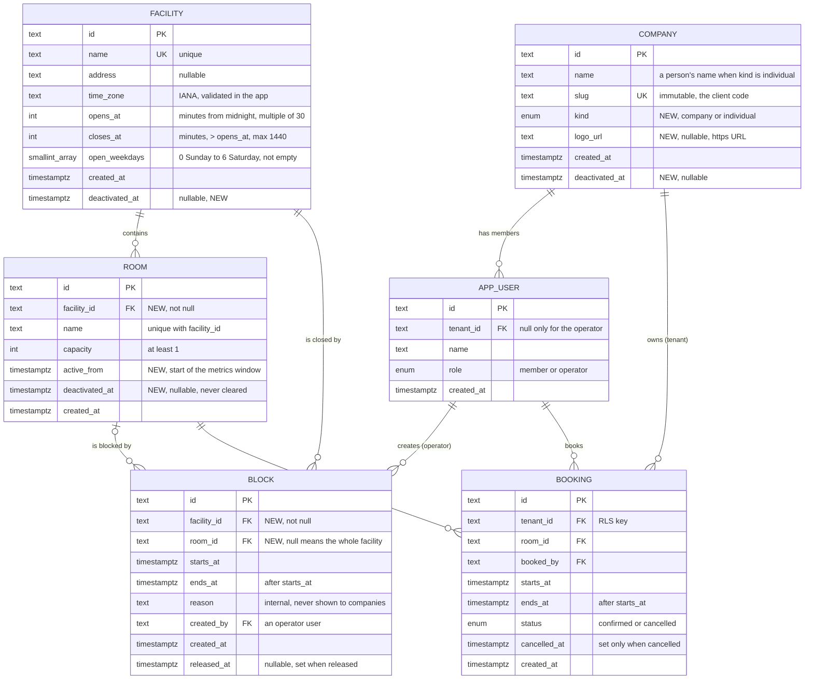

# 0004. Operator administration, facilities and metrics (data model and API)

**Date**: 2026-11-11
**Status**: In Progress

## Summary

The operator can grow the business through the API: add facilities (sedes), rooms and client companies, change them, and deactivate them without losing history. The data model gains a `facility` table that owns the time zone and opening hours, and rooms and companies get an on and off switch. The operator can also block a room, or a whole facility, for a period (maintenance, a holiday, a private event) so nobody can book it, and companies only see it as "not available". The operator also gets one global bookings list and four metric endpoints (rooms, companies, heatmap, insights) that already understand rooms joining or leaving in the middle of a period. This spec is backend only: data, rules and API. The screens come later.

## Requirements

**User stories**:
- As the operator, I want to register a person who works alone as a one member company, so that individuals book the same way as companies and can grow into a company later without migrating data.
- As the operator, I want to add a facility, a room or a client company without a deploy, so that the business can grow.
- As the operator, I want to deactivate a room, facility or company and keep its history, so that reports stay true.
- As the operator, I want to be told exactly which future bookings block a change, so that I can act on them.
- As the operator, I want to block a room or a whole facility for a period and release the block later, so that maintenance, holidays and private events never collide with bookings.
- As the operator, I want to see every booking of every company, so that I have the global view.
- As the operator, I want occupancy, company usage, a weekday by hour heatmap and a list of opportunities, so that I can fill quiet periods and reach idle clients.
- As a company member, I want to book only rooms that are open for business, and to see clear reasons when I cannot.

**Acceptance criteria** (the contract; each is checkable on its own):
- **AC-1**: Only the operator reaches `/api/v1/operator/*`. A member gets 403, no session gets 401. Every write also passes the Origin check and requires `Content-Type: application/json`.
- **AC-2**: The operator creates, lists, reads and edits facilities (`name` unique, `address`, `timeZone` as an IANA name, `opensAt` and `closesAt` in whole 30 minute marks, `openWeekdays`). An invalid zone, hours that do not satisfy `opensAt < closesAt` within one day, an empty weekday list or a duplicate name is refused with its own reason (400 `invalid_input` or 409 `already_exists`).
- **AC-3**: The operator creates, lists, reads and edits rooms (`name` unique inside its facility, `capacity` from 1, `facilityId`). A room cannot be created in an inactive facility (409 `facility_inactive`). A room is born active and its `activeFrom` is set to the creation instant unless the operator sends an earlier one (backfilling history).
- **AC-4**: The operator creates, lists, reads and edits clients (`name`, `slug` unique and immutable, `kind` of `company` or `individual`, immutable, optional `logoUrl`). `logoUrl` must be an `https` URL of at most 2048 characters; only the URL is stored, there is no file upload in v1. Creating a client also creates its first member in the same transaction (`member.name`, which defaults to the client name for an `individual`), so a client never exists without a user.
- **AC-21**: The operator adds and lists members of a client (`POST` and `GET /api/v1/operator/companies/{id}/members`). An `individual` holds exactly one member (a second is refused with 409 `individual_is_single`); a `company` holds as many as needed. A person who works alone is a client of kind `individual` and is treated by every rule (isolation, overlap, metrics) exactly like a company. Growing into a company is changing nothing but adding members to the same client (the `kind` stays as history). No role other than `member` can be created through the API.
- **AC-5**: Deactivating a room that has confirmed bookings starting after now is refused with 409 `has_future_bookings`, and the body lists them (id, room, company name, start, end, at most 50, plus the total). With none, the room gets `deactivatedAt = now` and never reopens (create a new room instead). Deactivating a facility is refused with 409 `facility_has_active_rooms` while it has active rooms.
- **AC-6**: Changing a facility's time zone, hours or open weekdays is refused with 409 `has_future_bookings` (same body) when any future confirmed booking of its rooms would fall outside the new rules. Otherwise it applies to all later booking checks.
- **AC-7**: Deactivating a company sets `deactivatedAt` and keeps everything it owns. From then on its members get 403 `company_inactive` when they try to book, and can still list and cancel their own bookings. The operator can reactivate a company.
- **AC-8**: A member booking an inactive room or a room of an inactive facility gets 409 `room_inactive`. This also holds under concurrency: a booking racing a deactivation either commits before it (and the deactivation is then refused as AC-5) or is refused, never both succeeding silently (P-16).
- **AC-9**: Booking rules read the opening hours, weekdays and time zone from the room's facility. The slot grid, length limits and horizon stay global. Availability, the booking form options and metrics use the same facility values. The database refuses a booking outside its facility's opening window even if a client skips the use case (P-17).
- **AC-10**: `GET /api/v1/operator/bookings` lists bookings of every company with the company name, filterable by `companyId`, `roomId`, `facilityId`, `status`, `from` and `to`, paged by keyset cursor (default 50, max 100), upcoming first.
- **AC-11**: `GET /api/v1/operator/metrics/rooms?from&to` returns occupancy per room, per facility and overall. Open minutes of a room count only inside its active window (`activeFrom` to `deactivatedAt`), each day in its facility's zone and opening hours. A room added mid range never lowers the occupancy of days before it existed.
- **AC-12**: `GET /api/v1/operator/metrics/companies?from&to` returns, for every company including idle and inactive ones, booked hours, confirmed count, cancelled count, cancellation rate, share of all booked hours and `lastBookingAt`, sorted by booked hours.
- **AC-13**: `GET /api/v1/operator/metrics/heatmap?from&to` (optional `facilityId`, `roomId`) returns weekday by hour occupancy. A booking is split across the hour cells it touches. A cell where no room is open is `null`, never 0.
- **AC-14**: `GET /api/v1/operator/metrics/insights?from&to&lowOccupancy=0.2` returns `lowUtilizationSlots` (weekday, hour, optional facility, occupancy, ordered from emptiest) and `promotionCandidates` (company, reasons, the numbers behind them). A zero denominator is `null` everywhere, never 0.
- **AC-15**: Every refusal uses the typed result and the JSON body `{ code, message }` of spec 0001 (plus `details` only for `has_future_bookings`), every new reason has one HTTP status and one es-AR message, and no raw database error reaches a response.
- **AC-16**: The existing member behavior of spec 0001 and spec 0003 keeps working: the seeded data migrates into one default facility and their tests pass after the facility values replace the constants.
- **AC-17**: The operator creates a block (`facilityId`, optional `roomId`, `startsAt`, `endsAt`, `reason`). Without `roomId` it covers every room of the facility (a closure or a holiday). `endsAt` must be after `startsAt` and in the future, and the facility and room must be active. Blocks may span several days.
- **AC-18**: Creating a block is refused with 409 `block_has_bookings` and the list of the confirmed bookings it would cover (same body as AC-5), until they are cancelled. Blocks are never edited: the operator releases it (`releasedAt`) and creates another. A released block no longer blocks anything. Nothing is deleted.
- **AC-19**: A booking that overlaps an active block is refused with 409 `room_blocked` and a fixed message that never shows the reason or who created it. This holds under concurrency (P-18). The use case checks first for a clean refusal, and the database trigger refuses a direct insert.
- **AC-20**: Companies never read blocks or their reasons. Availability shows a blocked interval as unavailable (`kind: "blocked"`, no reason, no author, no id), apart from `kind: "booked"` intervals. Only the operator lists blocks.

## Decision

**Chosen option**: Option 1: extend the existing schema in place with `facility`, `block` and `deactivated_at` columns, keep `booking` untouched, and give the operator login write access only to the catalog tables.

Facility owns the zone and opening hours. Rooms and companies are switched off with `deactivated_at`, never deleted. The operator writes through use cases and ports like everything else, and the database enforces the rules that races could break (active room, opening window) with a `BEFORE INSERT` trigger on `booking`.

**Implementation skills**: `architecture-boundaries` (local, `.claude/skills/architecture-boundaries/`) · `use-case-recipe` (local, `.claude/skills/use-case-recipe/`) · `multi-tenant-safety` (local, `.claude/skills/multi-tenant-safety/`) · `bff-edges` (local, `.claude/skills/bff-edges/`) · `pattern-catalog` (local, `.claude/skills/pattern-catalog/`) · `prisma-cli` and `prisma-client-api` (`prisma/skills`, `.claude/skills/`)

## Feature design

**Data model** (changes over spec 0001; `booking` and `app_user` do not change):

| Entity              | Fields                                                                                                                                                                                                                                            | Rules                                                                                                                                                                                                                       |
| ------------------- | ------------------------------------------------------------------------------------------------------------------------------------------------------------------------------------------------------------------------------------------------- | --------------------------------------------------------------------------------------------------------------------------------------------------------------------------------------------------------------------------- |
| `facility` (new)    | `id` PK, `name` unique, `address` nullable, `time_zone` text (IANA), `opens_at` int minutes, `closes_at` int minutes, `open_weekdays` smallint[] (0 Sunday to 6 Saturday, as `Date.getDay`), `created_at`, `deactivated_at` nullable              | `CHECK (opens_at < closes_at AND opens_at >= 0 AND closes_at <= 1440)`, both multiples of 30, `open_weekdays` not empty and each value 0 to 6. No RLS, read only for companies.                                             |
| `room` (changed)    | adds `facility_id` FK not null, `active_from` timestamptz not null, `deactivated_at` nullable                                                                                                                                                     | `name` unique per facility (`UNIQUE (facility_id, name)`, replaces the global unique). `deactivated_at` is set once and never cleared. Window = `[active_from, deactivated_at)`.                                            |
| `block` (new)       | `id` PK, `facility_id` FK not null, `room_id` FK nullable (null = the whole facility), `starts_at`, `ends_at`, `reason` text (internal, never shown to companies), `created_by` FK `app_user` (an operator), `created_at`, `released_at` nullable | `CHECK (ends_at > starts_at)`. Never edited or deleted: release sets `released_at`. No RLS and no grant to the company login (reached only through the availability function). A block applies while `released_at IS NULL`. |
| `company` (changed) | adds `deactivated_at` nullable, `kind` enum (`company` or `individual`, default `company`), `logo_url` text nullable                                                                                                                              | `slug` unique and immutable (it is the client's code). Also the tenant of an individual: a person is a client with one member. `kind` is immutable.                                                                         |

Relations: facility 1 to N room; facility 1 to N block; room 0 or 1 to N block; room 1 to N booking; company 1 to N booking and user; operator user 1 to N block.

**Diagram** (full target model; tables marked NEW or CHANGED are what this spec touches; ids are TEXT from the ids port, every timestamp is `timestamptz`):

Constraints the diagram cannot draw, all in the migration:
- `booking`: `EXCLUDE USING gist (room_id WITH =, tstzrange(starts_at, ends_at, '[)') WITH &&) WHERE (status = 'confirmed')`, RLS with `FORCE` on `tenant_id`, `CHECK (ends_at > starts_at)`, `CHECK ((status = 'cancelled') = (cancelled_at IS NOT NULL))`.
- `booking`: the new `BEFORE INSERT` guard trigger (active room, facility and company, inside the opening window, no active block overlapping).
- `block`: `CHECK (ends_at > starts_at)`, index `(facility_id, starts_at)` and `(room_id, starts_at)`. Overlapping blocks are allowed (their union applies), so there is no exclusion constraint.
- `app_user`: `CHECK ((role = 'member') = (tenant_id IS NOT NULL))`.
- `room`: `UNIQUE (facility_id, name)`. `facility`: the hours `CHECK`s listed above.
- Foreign keys are `ON DELETE RESTRICT`, and no role has `DELETE` on these tables.

Deliberately not modeled: restrictions that apply to one company only (a company specific holiday), and stored metric snapshots. Metrics are computed live from `booking` and `block` (no copy to keep in sync, see the rationale). Holidays and closures are blocks with no `room_id`.

Indexes: `room (facility_id)`, partial `room (id) WHERE deactivated_at IS NULL` is not needed at this size. Keep `booking (room_id, starts_at)` for metrics.

**Database rules that need hand written SQL** (in one migration, appended after `prisma migrate dev --create-only`):
- **Grants.** `espacios_operator` gets `INSERT, UPDATE` on `facility`, `room`, `company` and `block`, and `INSERT` on `app_user` (members only, the existing `CHECK` ties role to tenant and the use case never creates an operator). It gets nothing on `booking` and no `DELETE`. A grant cannot limit values, so a `BEFORE INSERT` trigger on `app_user` refuses an `operator` row coming from the operator login (SQLSTATE `42501`). `espacios_availability` gets `SELECT` on the `block` columns the function uses; `espacios_runtime` gets nothing on `block`. This amends the "operator is read only" lines of spec 0001, ADR 0003 and `packages/db/AGENTS.md`: the operator is now read only on tenant data and may write catalog data. `espacios_runtime` gets `SELECT` on `facility` and `company`.
- **Booking guard trigger.** `BEFORE INSERT ON booking`, a `SECURITY DEFINER` function owned by `espacios_owner` with `search_path = pg_catalog, pg_temp`. It locks the room, its facility and the company rows with `FOR SHARE`, then raises a custom SQLSTATE if the room, facility or company is inactive, or if the booking falls outside the facility's opening window (weekday, hours, zone), or if an unreleased `block` of its room or of the whole facility overlaps it. The `FOR SHARE` locks make a deactivation or an hours change wait for in flight inserts. The use cases map the custom SQLSTATE to `room_inactive`, `company_inactive`, `outside_hours` or `room_blocked`. The use case still checks the same things first so the usual refusal is a clean returned result with no write.
- **Availability function.** `room_busy_intervals` is rewritten to return confirmed bookings and the unreleased blocks that cover the room (its own and facility wide), each with a `kind` (`booked` or `blocked`) and nothing else. It stays `SECURITY DEFINER`, owned by `espacios_availability`.
- **Creating a block** runs in one operator transaction: lock the facility row `FOR UPDATE` (waits for in flight inserts, whose trigger holds it `FOR SHARE`), list confirmed bookings overlapping the range, refuse with the list if any, otherwise insert. A booking arriving after sees the block in the trigger.
- **Deactivation and hours change** run in one operator transaction: lock the row `FOR UPDATE`, then count or list future confirmed bookings (a new statement sees every insert that committed while it waited), then write. Concurrent inserts either commit before the lock (and are seen) or wait and are refused by the trigger.
- **Backfill.** Create one default facility from the old constants (Monday to Friday, 480 to 1200, `America/Argentina/Buenos_Aires`), attach every room to it, set `active_from = created_at`, then add `NOT NULL` and the new unique. Seeds set `active_from` to a fixed early date so seeded history counts.

**API surface** (cookie session, operator only unless noted; writes need the Origin check):

| Endpoint                                                    | Method     | Key inputs                                                                             | Key outputs                                                                                                  | Who                | Key errors                                                                                    |
| ----------------------------------------------------------- | ---------- | -------------------------------------------------------------------------------------- | ------------------------------------------------------------------------------------------------------------ | ------------------ | --------------------------------------------------------------------------------------------- |
| `/api/v1/operator/facilities`                               | GET        | `includeInactive` (default false)                                                      | facilities with room counts                                                                                  | operator           | 401, 403                                                                                      |
| `/api/v1/operator/facilities`                               | POST       | `name`, `address?`, `timeZone`, `opensAt`, `closesAt`, `openWeekdays`                  | facility, 201 + `Location`                                                                                   | operator           | 400, 409 `already_exists`                                                                     |
| `/api/v1/operator/facilities/{id}`                          | GET, PATCH | PATCH: any field except `id`                                                           | facility                                                                                                     | operator           | 400, 404, 409 `has_future_bookings` (hours, zone or weekdays)                                 |
| `/api/v1/operator/facilities/{id}/deactivate`               | POST       | none                                                                                   | facility                                                                                                     | operator           | 404, 409 `facility_has_active_rooms`                                                          |
| `/api/v1/operator/rooms`                                    | GET        | `facilityId?`, `includeInactive`                                                       | rooms with facility                                                                                          | operator           | 401, 403                                                                                      |
| `/api/v1/operator/rooms`                                    | POST       | `facilityId`, `name`, `capacity`, `activeFrom?`                                        | room, 201                                                                                                    | operator           | 400, 404, 409 `already_exists`, `facility_inactive`                                           |
| `/api/v1/operator/rooms/{id}`                               | GET, PATCH | PATCH: `name`, `capacity`                                                              | room                                                                                                         | operator           | 400, 404, 409                                                                                 |
| `/api/v1/operator/rooms/{id}/deactivate`                    | POST       | none                                                                                   | room                                                                                                         | operator           | 404, 409 `has_future_bookings`                                                                |
| `/api/v1/operator/companies`                                | GET        | `includeInactive`                                                                      | companies                                                                                                    | operator           | 401, 403                                                                                      |
| `/api/v1/operator/companies`                                | POST       | `name`, `slug`, `kind`, `logoUrl?`, `member.name?`                                     | company with its first member, 201                                                                           | operator           | 400, 409 `already_exists`                                                                     |
| `/api/v1/operator/companies/{id}/members`                   | GET, POST  | POST: `name`                                                                           | members, or the new member 201                                                                               | operator           | 400, 404, 409 `individual_is_single`                                                          |
| `/api/v1/operator/companies/{id}`                           | GET, PATCH | PATCH: `name`, `logoUrl` (null clears it)                                              | company                                                                                                      | operator           | 400, 404                                                                                      |
| `/api/v1/operator/companies/{id}/deactivate`, `/reactivate` | POST       | none                                                                                   | company                                                                                                      | operator           | 404                                                                                           |
| `/api/v1/operator/blocks`                                   | GET        | `facilityId`, `roomId`, `from`, `to`, `includeReleased`, `cursor`, `limit`             | `{ blocks, nextCursor }`                                                                                     | operator           | 400, 401, 403                                                                                 |
| `/api/v1/operator/blocks`                                   | POST       | `facilityId`, `roomId?`, `startsAt`, `endsAt` (with offset), `reason` (1 to 200 chars) | block, 201                                                                                                   | operator           | 400, 404, 409 `block_has_bookings`, `facility_inactive`, `room_inactive`, 422 `invalid_range` |
| `/api/v1/operator/blocks/{id}`                              | GET        | none                                                                                   | block                                                                                                        | operator           | 404                                                                                           |
| `/api/v1/operator/blocks/{id}/release`                      | POST       | none                                                                                   | block                                                                                                        | operator           | 404, 409 `already_released`                                                                   |
| `/api/v1/operator/bookings`                                 | GET        | `companyId`, `roomId`, `facilityId`, `status`, `from`, `to`, `cursor`, `limit`         | `{ bookings, nextCursor }` with company name                                                                 | operator           | 400, 401, 403                                                                                 |
| `/api/v1/operator/metrics/rooms`                            | GET        | `from`, `to`                                                                           | rooms, facilities, overall                                                                                   | operator           | 400, 422 `invalid_range`                                                                      |
| `/api/v1/operator/metrics/companies`                        | GET        | `from`, `to`                                                                           | companies                                                                                                    | operator           | 400, 422                                                                                      |
| `/api/v1/operator/metrics/heatmap`                          | GET        | `from`, `to`, `facilityId?`, `roomId?`                                                 | cells                                                                                                        | operator           | 400, 404, 422                                                                                 |
| `/api/v1/operator/metrics/insights`                         | GET        | `from`, `to`, `lowOccupancy?`                                                          | slots and candidates                                                                                         | operator           | 400, 422                                                                                      |
| `/api/v1/rooms` (changed)                                   | GET        | none                                                                                   | active rooms with `facility` (id, name, hours, zone)                                                         | any signed in user | 401                                                                                           |
| `/api/v1/rooms/{id}/availability` (changed)                 | GET        | `date`                                                                                 | uses the room's facility hours and zone; busy intervals carry `kind` (`booked` or `blocked`), never a reason | member, operator   | 400, 401, 404                                                                                 |

Notes: deactivate is a `POST` action, not a `DELETE`, because nothing is deleted. Rooms and facilities cannot be reactivated in v1 (their window is one interval); a company can, because no metric depends on its window.

**New reasons for the error contract** (one status and one es-AR message each, the iterating test of spec 0001 P-6 covers them): `already_exists` 409, `has_future_bookings` 409 (body adds `details`), `block_has_bookings` 409 (body adds `details`), `already_released` 409, `individual_is_single` 409, `facility_inactive` 409, `facility_has_active_rooms` 409, `room_inactive` 409, `room_blocked` 409 (fixed text, no reason), `company_inactive` 403.

**Metrics definitions** (replace the room, heatmap and company parts of spec 0001; all over `confirmed` bookings starting in the range; `from` and `to` are inclusive local days read in each facility's own zone):
- **Open minutes of a room** = for each local day in the range that is an open weekday of its facility, the minutes of `[opens_at, closes_at)` that fall inside the room's window `[active_from, deactivated_at)`, minus the minutes covered by blocks (the room's own and facility wide, released ones ignored; a released block only counts while it was active, so its `released_at` cuts it short). Blocked time cannot be booked, so it leaves the denominator and does not lower occupancy. Computed with `tstzmultirange` subtraction (PostgreSQL 17). The rooms endpoint also returns `blockedMinutes` per room.
- **Room occupancy** = booked minutes divided by open minutes. **Facility** and **overall** occupancy = sum of booked minutes divided by sum of open minutes of their rooms (a weighted ratio, never an average of ratios).
- **Company usage**: as spec 0001, plus `kind`, `lastBookingAt` and `active` (not deactivated). The endpoint takes an optional `kind` filter, so individuals and companies can be compared apart or together. `LEFT JOIN` so idle companies appear. Cancellation rate = `cancelled / (confirmed + cancelled)`, `null` with no bookings.
- **Heatmap**: weekday (0 to 6, only weekdays some facility opens) by hour of day. Occupancy = booked minutes in the cell divided by open minutes in the cell, summed over the rooms in scope. Bookings split across hour cells with `generate_series`. No open minutes gives `null`.
- **Low utilization slots**: heatmap cells whose occupancy is below `lowOccupancy` (default 0.2, between 0 and 1), `null` cells excluded, emptiest first, at most 20.
- **Promotion candidates**: active companies matching at least one reason. `no_bookings`: no confirmed booking in the range. `low_usage`: booked hours below 25% of the mean of active companies (only when at least 3 active companies). `high_cancellation`: cancellation rate at least 0.3 with at least 5 bookings. Each candidate carries its reasons and numbers. Ordered by number of reasons, then lowest booked hours. The thresholds are constants in `packages/domain` and go to the README Supuestos.

**Value sourcing**:

| Action                | Value                                         | Source                                                               |
| --------------------- | --------------------------------------------- | -------------------------------------------------------------------- |
| Validate a booking    | opening hours, weekdays, zone                 | the room's facility row, read in the same transaction (decided here) |
| Validate a booking    | slot grid, min and max length, horizon        | constants in `packages/domain` (spec 0001)                           |
| Create a room         | `activeFrom`                                  | input if given, else the clock port at creation                      |
| Create any record     | `id`                                          | the ids port (spec 0001)                                             |
| Deactivate            | `deactivatedAt` and "now" for future bookings | the clock port                                                       |
| Metrics               | local day boundaries                          | each facility's `time_zone` (decided here)                           |
| Metrics               | rooms in scope and their window               | `room.active_from`, `room.deactivated_at`                            |
| Operator booking list | company name                                  | join on `company`, operator edge only                                |
| Insights              | thresholds                                    | `lowOccupancy` input, the rest domain constants                      |
| Create a block        | `created_by`                                  | the operator in the session (decided here)                           |
| Block, release        | "now" and the future test                     | the clock port                                                       |
| Availability          | `kind` of an interval                         | `booking` row means `booked`, `block` row means `blocked`            |
| Admin writes          | who did it                                    | not recorded in v1 (see Follow-up)                                   |

**Key invariants**:
- No two confirmed bookings of a room overlap (unchanged, exclusion constraint).
- A booking is never created in an inactive room, facility or company, nor outside its facility's opening window, even under concurrency (trigger plus locks).
- Nothing is deleted: history and metrics survive deactivation.
- A booking never overlaps an active block of its room or facility, even under concurrency.
- A room's active window is one interval and never reopens.
- Every user is either a member of exactly one client or the operator. A client always has at least one member, and an `individual` has exactly one.
- The operator can write only `facility`, `room`, `company` and `block`, plus insert members into `app_user`, never `booking`.
- Companies never read `block`, only the anonymous `kind` through the availability function.
- Company isolation is unchanged: members still reach `booking` only through RLS.

**Patterns** (from `pattern-catalog`):
- A rule two requests can break together (deactivate versus book, hours change versus book, block versus book): database guard plus row locks, proofs P-16, P-17 and P-18.
- Second kind of client: the operator edge reuses the use cases and ports, with its own `OperatorCatalog` and `OperatorQueries` ports on the operator connection.
- Tenant data: unchanged; the new tables hold no tenant data, so no RLS.
- Two writes in one action: none (a single row each). Skipped.
- Cache and outside calls: none. Metrics are computed live.

**Security model**:
- Roles, Origin check and cookie as in spec 0001. Operator routes check the role in the edge and in the use case (authorization is a business rule: a pure `canManageCatalog(actor)` in `domain`).
- Names of companies reach only the operator. Members never receive another company's name, id or booking.
- No personal or regulated data is added.

**Configuration required**: none new. `DATABASE_OPERATOR_URL` already exists; its grants change in the migration. No new role, so no `docker compose down -v` is needed for roles, but local databases must run `pnpm db:deploy`.

**Critical test scenarios**:
- Happy path: create a facility, a room in it and a company; a member of that company books the room; the operator lists it and sees it in metrics, verifies **AC-2, AC-3, AC-4, AC-10, AC-11**.
- Failure case: deactivate a room with a future booking returns `has_future_bookings` with the list; after cancel it succeeds, verifies **AC-5**.
- Failure case: change hours so a future booking falls outside, refused with the list, verifies **AC-6**.
- Concurrency: book and deactivate the same room at once, at most one outcome is inconsistent (P-16), verifies **AC-8**.
- Database: a direct insert as `espacios_app` outside hours or into an inactive room is refused by the trigger (P-17), verifies **AC-9**.
- Metrics: a room created mid range, a deactivated room, two zones, a cancelled booking, an idle company and an empty range with known expected numbers, verifies **AC-11 to AC-14**.
- Auth: a member on every operator route gets 403, no cookie 401, a wrong Origin on a write is rejected, verifies **AC-1**.
- Grants: as `espacios_operator`, `INSERT` into `booking` fails and `INSERT` into `room` works, verifies **AC-1, AC-3**.
- Failure case: block a room for a range with a confirmed booking, refused with the list; after the cancel it works, and a booking in the blocked range gets `room_blocked`, verifies **AC-17, AC-18, AC-19**.
- Concurrency: create a block and book the same room and time at once, never both succeed (P-18), verifies **AC-19**.
- Privacy: as a member, availability shows `kind: "blocked"` with no reason or id, and `block` is unreadable for `espacios_app`, verifies **AC-20**.
- Metrics: a blocked day leaves the denominator, and a released block counts only until its release, verifies **AC-11, AC-13**.
- Individual: create a client of kind `individual`, its single member books, a second member is refused, and another client cannot see the booking; a growing `company` accepts more members, verifies **AC-4, AC-21**.
- Regression: the spec 0001 and 0003 booking proofs pass on the default facility, verifies **AC-16**.

## Build plan

Build approach is Tracer Bullet: one thin thread first (a facility and a room created through the API are bookable and show in metrics), then thicken.

1. Migration: `facility`, `block`, room and company columns, backfill, grants, booking guard trigger, drift check, seeds with a second facility in another zone for tests, satisfies **AC-2, AC-3, AC-8, AC-9, AC-16, AC-19**.
2. Domain: `FacilityRules` (zone, hours, weekdays) passed into `validateBooking` and the calendar helpers in place of the constants; pure `canManageCatalog`; new reasons in the result contract and the es-AR catalog, satisfies **AC-9, AC-15, AC-16**.
3. Member path on facility values: the room catalog returns facility data and hides inactive rooms; `bookRoom` and availability read the facility rules; map the trigger errors; the `company_inactive` check, satisfies **AC-7, AC-8, AC-9, AC-16**.
4. Thin thread, operator edge: `OperatorCatalog` port and use cases to create a facility and a room; the two `POST` handlers, satisfies **AC-1, AC-2, AC-3, AC-15**.
5. Rest of administration: list, read, edit and client handlers (client plus first member in one transaction, the members endpoint, the `kind` rules); deactivation use cases with the locks and the affected bookings body; hours change check, satisfies **AC-4, AC-5, AC-6, AC-7, AC-21**.
6. Blocks: use cases for create and release with the facility lock and the conflicting bookings list, the `blocks` handlers, the availability function with `kind`, the `room_blocked` refusal in `bookRoom`, satisfies **AC-17, AC-18, AC-19, AC-20**.
7. Operator bookings list with filters and cursor, satisfies **AC-10**.
8. Metrics queries (rooms, companies, heatmap, with blocks out of the open minutes) and handlers, satisfies **AC-11, AC-12, AC-13**.
9. Insights use case over the same queries, satisfies **AC-14**.
10. Proofs: integration tests P-16, P-17 and P-18, grants, metrics dataset, plus an `docs/api/operator.md` page documenting every endpoint, satisfies **AC-1 to AC-21**.
11. Amend spec 0001, ADR 0003 and `packages/db/AGENTS.md` for the operator write grants; add the new Supuestos.

## Consequences

**Positive**:
- Growth needs no deploy or schema change: new sedes, rooms and clients are API calls.
- History and reports stay true after deactivation.
- The hardest races are closed in the database, like the overlap rule.
- Metrics stay correct when rooms join or leave and when a second city appears.

**Negative / tradeoffs**:
- Built code changes: `validateBooking`, the calendar helpers, availability, the form options and seeds stop using constants (task 2 and 3 carry this risk, covered by AC-16).
- The operator login is no longer read only, a deliberate widening limited to three catalog tables.
- A trigger with locks is more machinery than a constraint; the proofs P-16 and P-17 are mandatory.
- Rooms and facilities cannot reopen in v1.
- Metric SQL per facility zone is more complex than one fixed zone.

**Neutral**:
- Holidays are handled as facility wide blocks created by the operator, not as an automatic calendar.
- Slot grid, length limits and horizon stay global.

## Follow-up

- [ ] A notification action for the bookings that block a change (the 409 already lists them).
- [ ] An audit trail of operator writes (who changed what and when).
- [ ] Reactivating rooms and facilities with multiple active windows.
- [ ] Recurring blocks (every Friday, an annual holiday list), restrictions for one company only, and per facility booking limits.
- [ ] Stored metric snapshots, only if live queries become slow (measure first).
- [ ] Enroll this work in `docs/scope/` (features 8 and 10 overlap with it) and amend spec 0001 where it says the operator writes nothing.
- [ ] Add the thresholds and the "no reactivation" rule to the README Supuestos.
- [ ] README Supuestos: every user belongs to a client (or is the operator). A person who works alone is a client of kind `individual` with one member, so tenant isolation stays one rule.
- [ ] The operator booking or cancelling on behalf of a client (courtesy bookings, resolving a block with bookings). In v1 the operator login has no write access to `booking`, so only members create and cancel bookings.
- [ ] A company admin role and member invitations (v1 has only `member` and `operator`, and the operator creates members).

## Migration plan

**Strategy**: no downtime concerns (local demo data), but the migration still follows the safe sequence in one file.
**Phases**:
1. Create `facility` and insert the default facility from the old constants.
2. Add `room.facility_id` nullable, `active_from` with a default, `deactivated_at`; backfill from the default facility and `created_at`; then set `NOT NULL` and swap the global name unique for `(facility_id, name)`.
3. Add `company.deactivated_at`, the grants and the booking guard trigger.
4. Move the code from constants to facility values (task 2 and 3 of the build plan) in the same feature branch.
   **Rollback**: revert the migration commit and run `docker compose down -v` locally; nothing here is deployed.
   **Risks**: the guard trigger can refuse existing seed bookings if a seed lies outside the facility hours (the seed test P-13 catches it); the code refactor can break the booking proofs (AC-16 covers it).

## Rationale

Reasoning and options: see [rationale.md](rationale.md).
